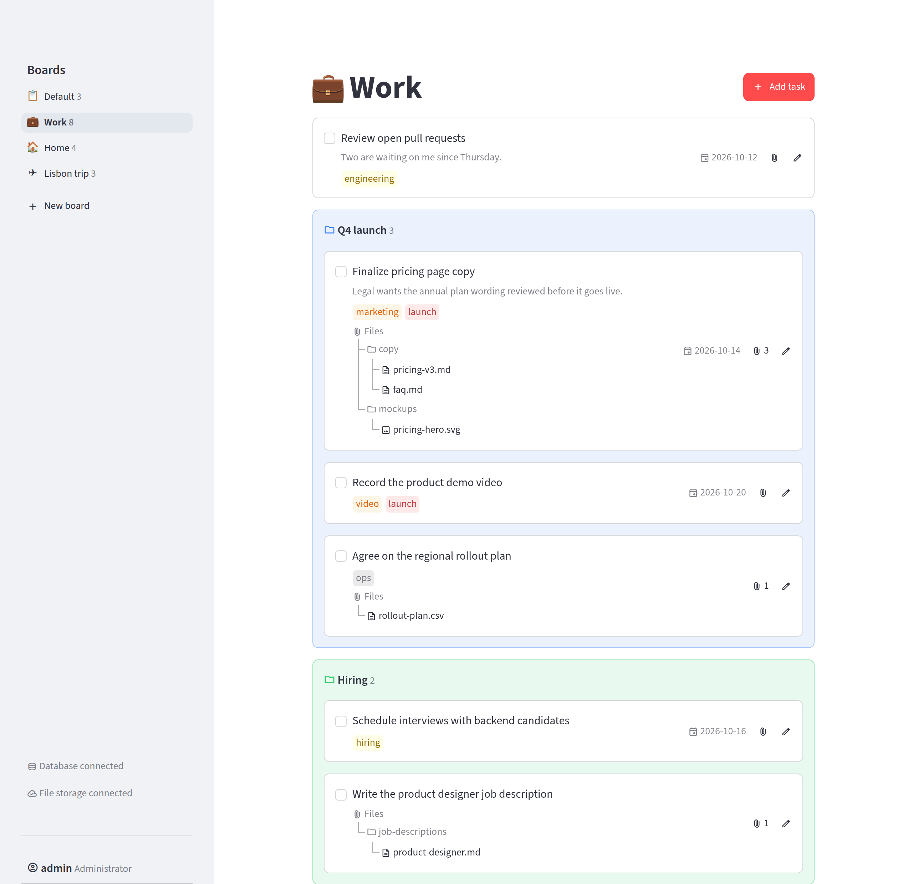
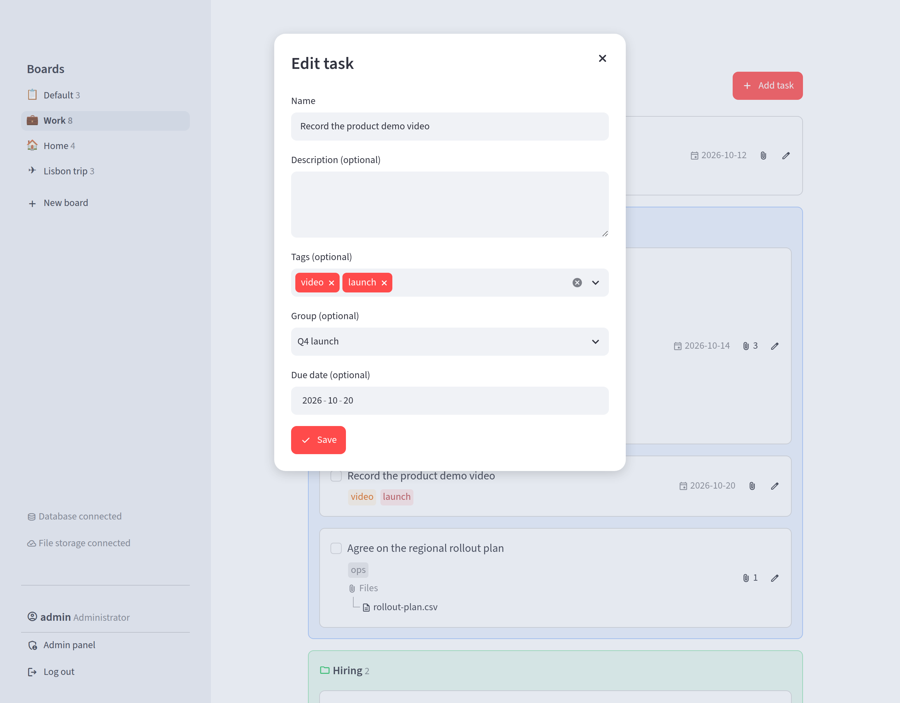
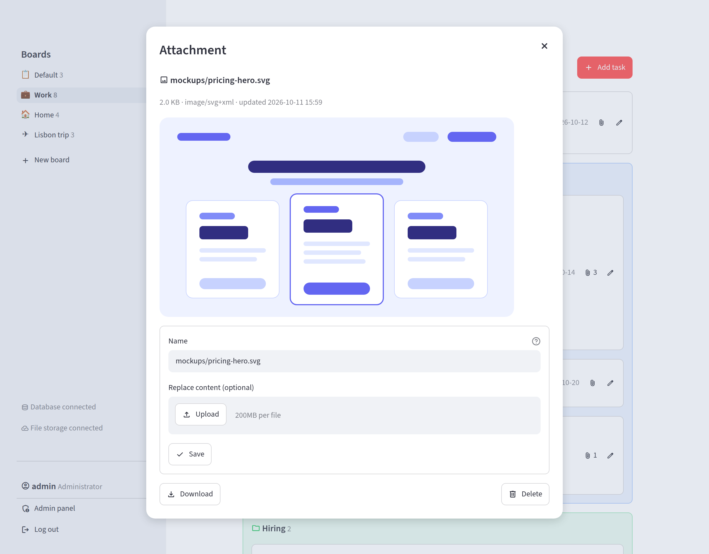
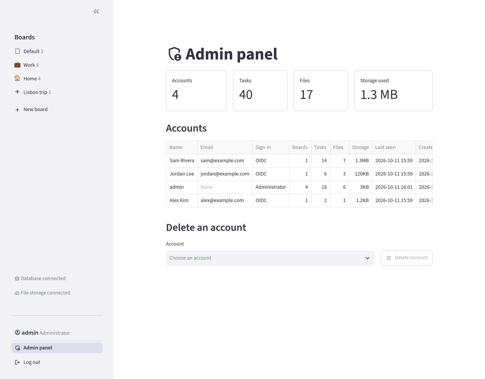

# Another Task Board

A task board built with [Streamlit](https://streamlit.io). Each person gets their own boards of tasks,
backed by PostgreSQL, with file attachments stored in S3-compatible storage.

<picture>
  <source media="(prefers-color-scheme: dark)" srcset="docs/screenshots/board-dark.png">
  
</picture>

## Screenshots

| Editing a task | Previewing an attachment |
| --- | --- |
|  |  |

| Admin panel |
| --- |
|  |

The app follows your system's light or dark theme.

## Features

- **Boards**: as many as you like, each with a name and an emoji icon, listed in the sidebar. The
  pencil next to "Add task" renames the board, changes its icon or deletes it with its tasks and files
  (except the default board, the one you land on after signing in).
- **Tasks**: a name, plus an optional description, tags, group, due date and attached files.
  Double-click a task to edit it. A completed task stays visible for a few seconds and can be undone.
- **Groups**: tasks in the same group are shown together in a tinted box, which stays on the board
  when its last task is done or moved out. The pencil in the box's corner renames the group or deletes
  it; its tasks then stay on the board without a group.
- **Drag and drop**: reorder tasks and groups, move tasks in or out of groups, or drop them onto
  another board in the sidebar.
- **Attachments**: add, preview, download, rename, replace and delete files on a task.
- **Accounts**: the administrator signs in with a login and password; everyone else signs in with
  OIDC and gets their own account on first sign-in. The administrator's admin panel lists every
  account with how much it stores, and can delete an account with all its data.
- **MCP server**: AI assistants such as Claude can list, add, change and complete your tasks, each
  with an access token that you create in the app (see [below](#connecting-an-ai-assistant-mcp)).

## Running with Docker Compose

```sh
cp .env.example .env               # then set the passwords, and the login variables (see below)
docker compose up -d
```

This starts the app at <http://localhost:8501>, PostgreSQL on port 5432 and RustFS (S3 API on 9000,
web console on 9001), all reachable from this machine only. The database tables and the storage
bucket are created on first use.

The app runs the image that every push to `master` publishes to GHCR, tagged `latest`, the date
(`YYYY-MM-DD`) and the commit SHA. To run your own changes instead, build it from the checkout with
`docker compose up -d --build`. In compose, the app reaches the database and storage by their
service names, so the `TASKBOARD_DB_HOST`, `TASKBOARD_DB_PORT` and `TASKBOARD_S3_ENDPOINT_URL` set
in `.env` are ignored there.

## Running locally

For development, run the app from the checkout with Python 3.12+ and only the database and storage
in Docker:

```sh
docker compose up -d db rustfs

python -m venv .venv
. .venv/bin/activate
pip install -r requirements.txt

streamlit run asgi_app.py
```

## Running the image on its own

```sh
docker run --env-file .env -p 8501:8501 ghcr.io/ptylczynski/another-task-board:latest
```

Inside a container, `localhost` is the container itself, so point `TASKBOARD_DB_HOST` and
`TASKBOARD_S3_ENDPOINT_URL` at addresses it can reach.

## Configuration

Everything is configured with environment variables, which can also be put in a `.env` file next to
the app; variables already set in the environment take precedence. See [`.env.example`](.env.example).

### Database

| Variable | Default | |
| --- | --- | --- |
| `TASKBOARD_DB_HOST` | | Required, unless `TASKBOARD_DATABASE_URL` is set |
| `TASKBOARD_DB_PORT` | `5432` | |
| `TASKBOARD_DB_NAME` | `taskboard` | |
| `TASKBOARD_DB_USER` | `taskboard` | |
| `TASKBOARD_DB_PASSWORD` | | |
| `TASKBOARD_DATABASE_URL` | | A full SQLAlchemy URL; takes precedence over the variables above |

Without any of these, the app falls back to `[connections.sql]` in `.streamlit/secrets.toml`.

### File storage

| Variable | Default | |
| --- | --- | --- |
| `TASKBOARD_S3_BUCKET` | | Required to enable attachments |
| `TASKBOARD_S3_ENDPOINT_URL` | | For non-AWS services such as RustFS; leave unset for AWS S3 |
| `TASKBOARD_S3_ACCESS_KEY` | | Without these two, boto3's usual credential sources are used |
| `TASKBOARD_S3_SECRET_KEY` | | |
| `TASKBOARD_S3_REGION` | `us-east-1` | |

### Login

| Variable | |
| --- | --- |
| `TASKBOARD_LOGIN`, `TASKBOARD_PASSWORD` | The administrator's credentials; both are needed |
| `TASKBOARD_OIDC_CLIENT_ID` | OIDC for everyone else; all five are needed |
| `TASKBOARD_OIDC_CLIENT_SECRET` | |
| `TASKBOARD_OIDC_SERVER_METADATA_URL` | The provider's `.well-known/openid-configuration` URL |
| `TASKBOARD_OIDC_REDIRECT_URI` | e.g. `http://localhost:8501/oauth2callback` |
| `TASKBOARD_OIDC_COOKIE_SECRET` | A long random string |
| `TASKBOARD_AUTH_DISABLED` | Set to `1` to skip login: everyone shares one anonymous account |

The OIDC variables only take effect when the app is started with `streamlit run asgi_app.py`.
Alternatively, configure OIDC under `[auth]` in `.streamlit/secrets.toml`, which also allows several
named providers. With no login method configured, access is blocked.

## Connecting an AI assistant (MCP)

The app serves an [MCP](https://modelcontextprotocol.io) server at `/mcp`, next to the app
(e.g. <http://localhost:8501/mcp>), over Streamable HTTP. It's only served when the app is started
with `streamlit run asgi_app.py`, as the Docker image does.

Each request needs an access token. To create one, click **MCP access** in the sidebar, name the token
and copy it: it's shown only once. The dialog also lists your tokens with when they were last used,
and revokes them. An assistant using a token works on the boards of the account that created it.
For example, to connect Claude Code:

```sh
claude mcp add --transport http task-board http://localhost:8501/mcp \
  --header "Authorization: Bearer <token>"
```

The tools are `list_boards`, `list_tasks`, `add_task`, `update_task`, `complete_task` and
`reopen_task`. Boards are named by their name or id, and tasks by their id, which `list_tasks` shows.
Attachments are listed by name only.

## Project layout

| File | |
| --- | --- |
| `asgi_app.py` | Entry point; passes the OIDC variables to Streamlit and serves the MCP server |
| `streamlit_app.py` | The boards, tasks and dialogs |
| `auth_gate.py` | Login page and accounts |
| `admin_panel.py` | Admin panel |
| `task_store.py` | Accounts, boards, tasks and attachment metadata in PostgreSQL |
| `mcp_server.py` | MCP server and its access token check |
| `db.py` | Database connection |
| `file_store.py` | Attachment contents in S3 |
| `task_files.py` | Attachment UI |
| `task_dnd.py`, `task_dblclick.py` | Drag-and-drop and double-click components |
| `board_icons.py` | Emoji choices for board icons |
